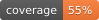

# Penalized Transformation Models in Liesel

[](https://github.com/liesel-devs/liesel-ptm/actions/workflows/pre-commit.yml)
[](https://github.com/liesel-devs/liesel-ptm/actions/workflows/pytest.yml)
[](https://github.com/liesel-devs/liesel-ptm/actions/workflows/pytest.yml)


Penalized Transformation Models are a class of flexible structured additive
distributional regression models. This is a Python library for estimating these models
with Markov Chain Monte Carlo (MCMC) methods.

Learn more in the paper:

Brachem, J., Wiemann, P. F. V., & Kneib, T. (2024). Bayesian penalized transformation models: Structured additive location-scale regression for arbitrary conditional distributions (No. arXiv:2404.07440). arXiv. `https://doi.org/10.48550/arXiv.2404.07440 <https://doi.org/10.48550/arXiv.2404.07440>`_

Application examples are included in the supplementary materials for the paper, which
can be found here: https://github.com/liesel-devs/ptm-supplement

## Installation

The library can be installed from GitHub:

```
$ pip install git+https://github.com/liesel-devs/liesel-ptm.git
```


## Getting Started


Construct predictors and terms with [liesel-gam](https://github.com/liesel-devs/liesel-gam).
This minimal model has a smooth location effect, a constant scale, and a shared
transformation shape. The data are synthetic.

```python
import jax
import jax.numpy as jnp
import liesel.model as lsl
import liesel_gam as gam

import liesel_ptm as ptm

x = jnp.linspace(-2.0, 2.0, 100)
y = jnp.sin(x) + jax.random.normal(jax.random.key(42), x.shape)
builder = gam.TermBuilder(gam.DictRegistry({"x": x}))

loc = gam.AdditivePredictor("loc")
loc += builder.ps("x", k=10)
scale = gam.AdditivePredictor("scale", inv_link=jnp.exp)

knots = ptm.PTMKnots(-4.0, 4.0, nparam=6)
shape = gam.MVAdditivePredictor.from_random_walk(
    "delta",
    ndim=knots.nparam,
    intercept=False,
).constrain("sumzero_coef")
shape_builder = gam.MVTermBuilder.from_predictor(shape, term_builder=builder)
shape.intercept = shape_builder.intercept(scale=gam.scale_wb(0.1, scale=0.05))

response = lsl.Var.new_obs(
    y,
    dist=ptm.PTMDist(
        knots.knots,
        loc=loc,
        scale=scale,
        shape=shape,
        bspline="ptm",
        centered=True,
        scaled=True,
    ),
    name="y",
)
model = lsl.Model(response)
```

For fitting, prediction, and more model components, see the reference examples:

- [Modern GPTM](demo/reference_modern.py): location, scale, and shape predictors; optimization and VI.
- [Legacy PTM](demo/reference_legacy.py): shared shape and computed intercepts.
