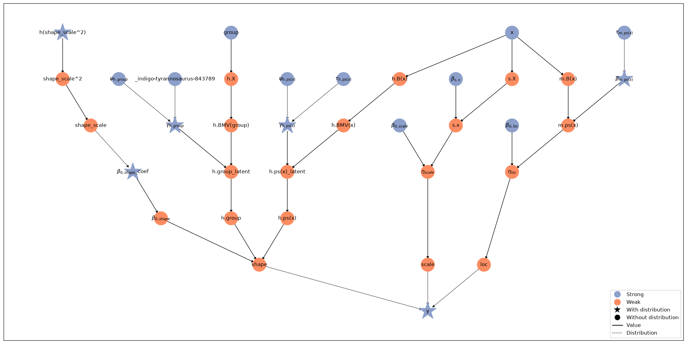
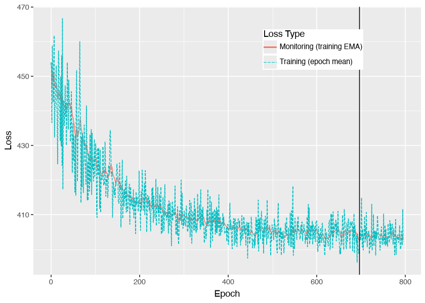
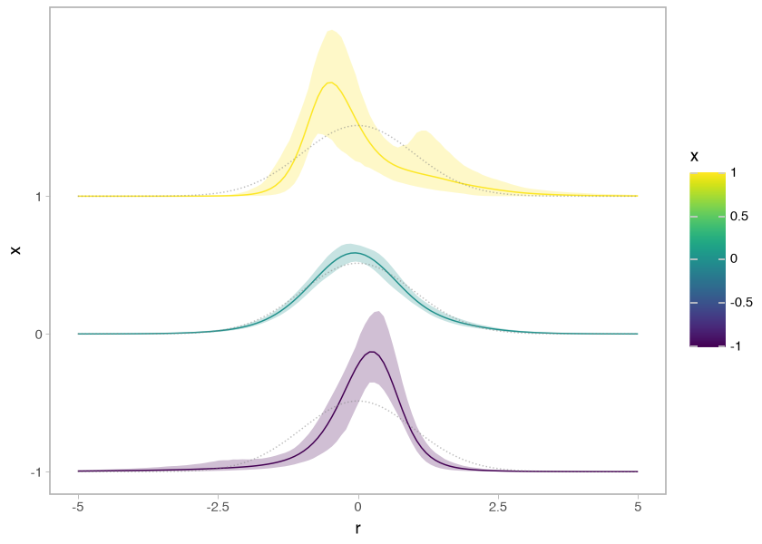
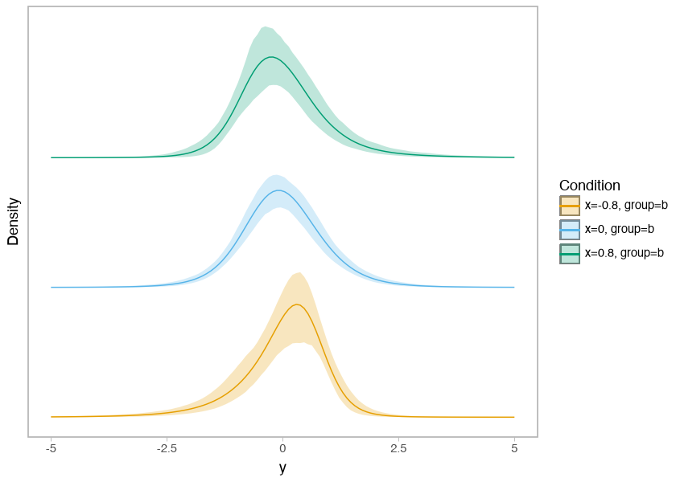
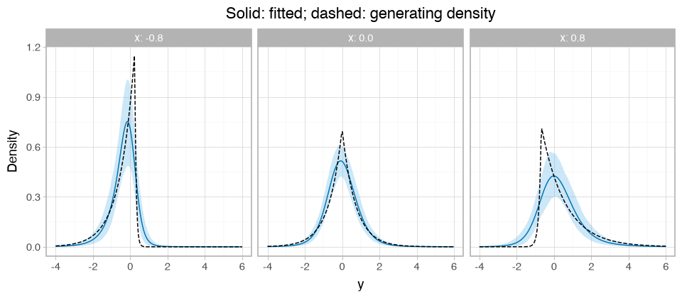

# Fit a conditional-shape PTM


Fit a conditional-shape penalized transformation model (PTM), in which covariates
can change the conditional mean, standard deviation, and standardized distributional
shape. Use variational inference (VI) to fit the model, then predict at new covariate
values. See [model variants](../index.md#model-variants) for the fixed-shape variant
of this formulation and the separate legacy PTM.

This example uses 300 synthetic observations with a nonlinear mean, changing
scale, and skewness that changes direction with `x`. A small variational fit
recovers visible shape differences. Early stopping keeps the example short;
assess convergence and approximation quality before using it for inference.

Install the [checkout environment](../contributing.md#build-the-documentation)
before running the cells from top to bottom. Graphviz is needed for the model graph.

## Set up the data

The observed response is $y_i$. Its conditional mean $\mu_i$ (location), standard
deviation $\sigma_i$ (scale), and shape coefficients $\delta_i$ depend on the
covariates. The
transformation maps $r_i = (y_i - \mu_i) / \sigma_i$ to a standard normal scale:

$$
P(Y_i \le y) = \Phi\left(h_{\delta_i}((y - \mu_i) / \sigma_i)\right).
$$

Estimate the predictor coefficients and the shape intercept’s smoothing variance.
Keep the knot grid and the other prior scales fixed. With centering and scaling
enabled, $\mu_i$ and $\sigma_i$ are the conditional mean and standard deviation.

``` python
import jax
import jax.numpy as jnp
import liesel.optim as opt
import liesel_gam as gam
import numpy as np
import optax
import pandas as pd
import plotnine as p9
from IPython.display import Markdown

import liesel_ptm as ptm
```

``` python
rng = np.random.default_rng(42)
x = np.tile(np.linspace(-1.0, 1.0, 100), 3)
group = pd.Categorical(np.repeat(["a", "b", "c"], 100))
weight = 1.0 / (1.0 + np.exp(-3.0 * x - 0.6 * (group.codes - 1)))
right = rng.exponential(size=x.size) - 1.0
left = rng.exponential(size=x.size) - 1.0
residual = (weight * right - (1.0 - weight) * left) / np.sqrt(
    weight**2 + (1.0 - weight) ** 2
)
y = 0.8 * np.sin(np.pi * x) + np.exp(0.3 * x) * residual
data = pd.DataFrame({"x": x, "group": group, "y": y})
registry = gam.PandasRegistry(data)
```

The residual combines two independent, centered exponential variables. At small
`x`, the negative contribution dominates and gives a long left tail; at large `x`,
the positive contribution gives a long right tail. The denominator keeps its
conditional variance at one. Thus the conditional mean is `0.8 * sin(pi * x)` and
the standard deviation is `exp(0.3 * x)` throughout. Group shifts where the skewness
changes direction, with 100 observations per group.

The registry keeps the observed data and encodes the three categories in `group`.
The fixed random seed makes the response reproducible.

## Initialize the model

[PTM](../api/models.md#liesel_ptm.PTM) creates a Liesel model with location,
scale, and shape predictors in `model.pred`. It sets up the onion spline and
both standardization corrections, so location and scale represent the conditional
mean and standard deviation. By default, each predictor has an intercept; the
shape intercept has a Weibull smoothing-variance prior.

``` python
model = ptm.PTM(registry.get_obs("y"), nshape=8, bounds=(-4.0, 4.0))
```

`nshape=8` selects eight shape coefficients before the sum-to-zero constraint,
leaving seven latent dimensions. The bounds describe the flexible interval on the
standardized residual scale. Add all terms before creating inference objects.

## Define location and scale

Use a smooth location effect and a linear effect on log scale. The scale
predictor applies an exponential inverse link, so its values stay positive.
Eight basis functions let the location smooth represent the sine-shaped mean.

``` python
tb_loc = gam.TermBuilder(registry, prefix_names_by="m.")
tb_scale = gam.TermBuilder(registry, prefix_names_by="s.")

model.pred.loc += tb_loc.ps("x", k=8, scale=1.0)
model.pred.scale += tb_scale.lin("x", name="s.x")
```

## Define shape effects

Add smooth and categorical terms to the shape predictor. The constructor already
supplies its constrained intercept and prior. Use a multivariate term builder to
match the predictor’s dimension and constraint.

``` python
shape = model.pred.shape
tb_shape_base = gam.TermBuilder(registry, prefix_names_by="h.")
tb_shape = gam.MVTermBuilder.from_predictor(shape, term_builder=tb_shape_base)
shape += tb_shape.ps("x", k=5, scale=0.5, dimension_scale=0.7)
shape += tb_shape.lin("group", dimension_scale=0.7, name="h.group")
```

The model’s response is available as `model.response` for distribution summaries
and plots. `PTM` inherits Liesel’s model methods, including `plot()` and `predict()`.

``` python
model.plot(width=24, height=12)
```



The graph shows separate location, scale, and shape predictors feeding the response.
The smoothing variance belongs to the shape intercept’s prior.

## Find starting values

First optimize location and scale while holding shape fixed. Then optimize shape
while holding location and scale fixed. Each stage starts from the previous result.
The parameter lists include the priors’ parameters as well as term coefficients.

``` python
loc_scale_parameters = list(model.parental_submodel(model.pred.loc).parameters)
loc_scale_parameters += list(model.parental_submodel(model.pred.scale).parameters)
shape_parameters = list(model.parental_submodel(model.pred.shape).parameters)

for parameters in (loc_scale_parameters, shape_parameters):
    result = opt.LieselOptim(
        model,
        optimizers=[opt.Optimizer(parameters, optax.adam(0.01))],
        loss_monitor="train_full_data",
        stopper=opt.Stopper(epochs=600, patience=600),
        seed=43,
        show_progress=False,
    ).fit()
    model.state = model.update_state(result.position_min_monitor)
point = {name: var.value for name, var in model.parameters.items()}
```

`point` contains one fitted value per model parameter. These values initialize the
variational family; they are not posterior draws.

## Fit a variational family

Use a full-covariance Gaussian block for location and scale and a diagonal Gaussian
block for shape. Train the blocks separately, then jointly, using eight Monte Carlo
samples for each ELBO estimate.

Use an Adam learning rate of `0.003` and monitor an exponential moving average
(EMA) of the training loss with an effective window of 20 updates. This smooths
the noisy Monte Carlo estimates. Each update uses the complete dataset here.

Allow each stage at least 300 epochs, then use a patience window of 100 epochs.
Stop when the best EMA in that window improves on its oldest value by no more
than a relative tolerance of `1e-4`. The 3,000-epoch limit caps the runtime if this
condition is not reached.

``` python
loc_scale_block = opt.VDist(loc_scale_parameters, model).mvn_tril()
shape_block = opt.VDist(shape_parameters, model).mvn_diag()
family = opt.CompositeVDist(loc_scale_block, shape_block).build()
loss = opt.NegElboLoss.from_vdist(family, nsamples=8)
vi_runs = []
for stage, parameters in (
    ("location and scale", loc_scale_block.parameters),
    ("shape", shape_block.parameters),
    ("joint", family.parameters),
):
    result = opt.LieselVI(
        model,
        loss=loss,
        optimizers=[opt.Optimizer(parameters, optax.adam(0.003))],
        loss_monitor=opt.EmaTrainLossMonitor(effective_window=20),
        stopper=opt.Stopper(epochs=3000, patience=100, min_epochs=300, rtol=1e-4),
        seed=44,
        show_progress=False,
    ).fit()
    family.q.state = family.q.update_state(result.position_final)
    vi_runs.append({"stage": stage, "epochs": result.n_epochs, "status": result.status})
```

Check how long each stage ran and whether it stopped early or reached the cap:

``` python
Markdown(pd.DataFrame(vi_runs).to_markdown(index=False))
```

| stage              | epochs | status         |
|:-------------------|-------:|:---------------|
| location and scale |    389 | early_stopping |
| shape              |    893 | early_stopping |
| joint              |    796 | early_stopping |

Draw 1,000 samples from the fitted family for posterior summaries and plots. The
leading sample axes are `(1, 1000)`: one sample group containing 1,000 approximate
posterior draws. Parameter dimensions follow those axes. This draw count is
separate from the eight Monte Carlo samples used to estimate the ELBO during
training.

``` python
posterior = loss.approximate_joint_posterior(result)
samples = posterior.sample((1, 1000), seed=jax.random.key(45))
```

``` python
sample_shapes = pd.DataFrame(
    {"parameter": list(samples), "shape": [value.shape for value in samples.values()]}
)
Markdown(sample_shapes.to_markdown(index=False))
```

| parameter               | shape         |
|:------------------------|:--------------|
| $\beta_{0,loc}$         | (1, 1000)     |
| $\beta_{0,scale}$       | (1, 1000)     |
| $\beta_{0,shape}$\_coef | (1, 1000, 7)  |
| $\beta_{m.ps(x)}$       | (1, 1000, 7)  |
| $\beta_{s.x}$           | (1, 1000, 1)  |
| $\gamma_{h.group}$      | (1, 1000, 14) |
| $\gamma_{h.ps(x)}$      | (1, 1000, 28) |
| h(shape_scale^2)        | (1, 1000)     |

The sample dictionary has the same parameter names as `model.parameters`. Inspect
the final joint training stage’s loss before interpreting its samples.

``` python
result.plot_loss()
```



The training loss fluctuates while the EMA shows its recent trend with some lag.
The EMA smooths the same training estimates; it is not a validation loss. We keep
the final variational parameters for sampling. Early stopping detects a plateau
in the monitored loss; it does not establish that the Gaussian family captures
the posterior well. Check sensitivity to the stopping settings and assess
approximation quality for an analysis. More posterior draws reduce Monte Carlo
noise in summaries, but do not improve the fitted approximation itself.

## Plot location and scale effects

Use liesel-gam’s `plot_1d_smooth()` for the smooth location term. Its blue curve
and ribbon show the posterior mean and pointwise 5th to 95th percentiles. The
dashed curve is the generating effect. The smooth excludes the location intercept;
the generating effect has mean zero over the training inputs.

``` python
effect_x = np.linspace(-1.0, 1.0, 100)
true_location = pd.DataFrame({"x": effect_x, "effect": 0.8 * np.sin(np.pi * effect_x)})
location_effect = gam.plot_1d_smooth(
    model.pred.loc.terms["m.ps(x)"], samples, show_n_samples=0
)
```

``` python
(
    location_effect
    + p9.geom_line(
        p9.aes("x", "effect"),
        data=true_location,
        inherit_aes=False,
        linetype="dashed",
    )
    + p9.labs(title="Location effect", y="Effect on mean")
)
```


The scale effect is linear, so use liesel-gam’s `plot_forest()` to inspect its
coefficient. The dashed line marks the generating log-scale slope of `0.3`.
A one-unit increase in `x` multiplies the conditional standard deviation by
`exp(slope)`.

``` python
(
    gam.plot_forest(
        model.pred.scale.terms["s.x"], samples, ymin="q_0.05", ymax="q_0.95"
    )
    + p9.geom_hline(yintercept=0.3, linetype="dashed")
    + p9.labs(title="Linear effect on log scale", x="", y="Coefficient")
    + p9.theme(figure_size=(7, 2.5))
)
```


## Predict at new covariates

Use `model.predict()` to evaluate the predictors for every draw. Supply the group
labels used in the training data for new categorical inputs.

``` python
prediction = model.predict(
    samples,
    predict=["loc", "scale", "shape"],
    newdata={"x": jnp.array([-0.5, 0.5]), "group": ["a", "b"]},
)
```

``` python
prediction_shapes = pd.DataFrame(
    {
        "predictor": list(prediction),
        "shape": [value.shape for value in prediction.values()],
    }
)
Markdown(prediction_shapes.to_markdown(index=False))
```

| predictor | shape           |
|:----------|:----------------|
| loc       | (1, 1000, 2)    |
| scale     | (1, 1000, 2)    |
| shape     | (1, 1000, 2, 8) |

Location and scale have axes `(sample group, draw, new observation)`. Shape adds
one final axis for the eight shape coefficients. These are conditional parameter
draws; no new responses have been simulated.

## Inspect a shape effect

Plot the smooth term’s [term-induced standardized distribution](term-distributions.md).
Include the shape intercept explicitly. Location, scale, and the categorical shape
term are excluded from this display.

``` python
shape = model.pred.shape
smooth = shape.terms["h.ps(x)"]
effect = ptm.plot_1d_smooth_dist(
    model.response,
    smooth,
    samples,
    intercept=shape.intercept,
    ngrid=3,
    rgrid=120,
)
```

``` python
effect
```



At small `x`, look for a longer left tail; at large `x`, look for a longer right
tail. The gray dotted curves show the standard normal reference. These differences
remain after removing location and scale, so they describe shape rather than a
changing mean or variance. The ribbons show pointwise 5th to 95th percentiles under
the fitted variational approximation.

This display isolates the smooth term and shared shape intercept. To include the
categorical effect too, compare complete standardized conditional distributions
for group `b`:

``` python
ptm.plot_conditional_dist(
    model.response,
    samples,
    newdata={"x": [-0.8, 0.0, 0.8], "group": ["b", "b", "b"]},
    rgrid=120,
)
```



## Compare fitted and true conditional distributions

Compare complete response densities for group `b` at three values of `x`.
Include location and scale so the comparison is in the original response units.
The true density uses the same weighted difference of independent exponential
variables as the data generator. For group `b`, the group offset in `weight` is
zero. The change-of-scale factor below accounts for both residual standardization
and the conditional standard deviation.

``` python
def true_density(y, x):
    mu = 0.8 * np.sin(np.pi * x)
    sigma = np.exp(0.3 * x)
    weight = 1.0 / (1.0 + np.exp(-3.0 * x))
    residual_sd = np.sqrt(weight**2 + (1.0 - weight) ** 2)
    difference = residual_sd * (y - mu) / sigma + 2.0 * weight - 1.0
    log_density = np.where(
        difference >= 0.0, -difference / weight, difference / (1.0 - weight)
    )
    return residual_sd / sigma * np.exp(log_density)


comparison = ptm.summarise_conditional_dist(
    model.response,
    samples,
    newdata={"x": [-0.8, 0.0, 0.8], "group": ["b", "b", "b"]},
    rgrid=jnp.linspace(-4.0, 6.0, 240),
    include_loc=True,
    include_scale=True,
)
density = comparison.loc[comparison["quantity"] == "density"].copy()
density["truth"] = true_density(density["r"].to_numpy(), density["x"].to_numpy())
```

``` python
(
    p9.ggplot(density, p9.aes("r"))
    + p9.geom_ribbon(p9.aes(ymin="q_0.05", ymax="q_0.95"), fill="#56B4E9", alpha=0.3)
    + p9.geom_line(p9.aes(y="mean"), color="#0072B2")
    + p9.geom_line(p9.aes(y="truth"), linetype="dashed")
    + p9.facet_wrap("~x", nrow=1, labeller="label_both")
    + p9.labs(title="Solid: fitted; dashed: generating density", x="y", y="Density")
    + p9.theme_light()
    + p9.theme(figure_size=(8, 3.5))
)
```



The solid blue curves average fitted densities over draws, with pointwise 5th
to 95th percentile bands. The dashed curves are the exact generating densities.
Unlike the isolated smooth-term display, this comparison includes the categorical
shape effect as well as location and scale. Look for the change in tail direction
across panels and for regions where the fitted model misses the generating shape.
Differences can reflect finite data, spline approximation, and VI.

See the [summary API](../api/summaries.md) for tidy numerical summaries and the
[plot API](../api/plots.md) for display options.
