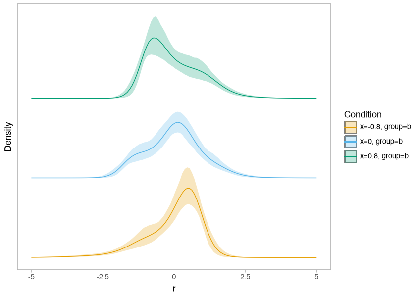

# Fit a conditional-shape PTM


Fit a conditional-shape penalized transformation model (PTM), in which covariates
can change the conditional mean, standard deviation, and standardized distributional
shape. Use variational inference (VI) to fit the model, then predict at new covariate
values. See [model variants](../index.md#model-variants) for the fixed-shape variant
of this formulation and the separate legacy PTM.

This example uses 24 synthetic observations so it runs quickly.
The two training epochs and three posterior draws demonstrate the workflow;
they do not establish convergence or support substantive inference.

Install the [checkout environment](../contributing.md#build-the-documentation)
before running the cells from top to bottom. Graphviz is needed for the model graph.

## Set up the data

The observed response is $y_i$. Its conditional mean $\mu_i$ (location), standard
deviation $\sigma_i$ (scale), and shape coefficients $\delta_i$ depend on the
covariates. The
transformation maps $r_i = (y_i - \mu_i) / \sigma_i$ to a standard normal scale:

$$
P(Y_i \le y) = \Phi\left(h_{\delta_i}((y - \mu_i) / \sigma_i)\right).
$$

Estimate the predictor coefficients and the shape intercept’s smoothing variance.
Keep the knot grid and the other prior scales fixed. With centering and scaling
enabled, $\mu_i$ and $\sigma_i$ are the conditional mean and standard deviation.

``` python
import jax
import jax.numpy as jnp
import liesel.model as lsl
import liesel.optim as opt
import liesel_gam as gam
import numpy as np
import optax
import pandas as pd
import tensorflow_probability.substrates.jax.distributions as tfd
from IPython.display import Markdown

import liesel_ptm as ptm
```

``` python
x = np.linspace(-1.0, 1.0, 24)
y = 0.5 * x + np.exp(0.15 * x) * np.random.default_rng(42).normal(size=x.size)
data = pd.DataFrame(
    {"x": x, "group": pd.Categorical(np.tile(["a", "b", "c"], 8)), "y": y}
)
registry = gam.PandasRegistry(data)
```

The registry keeps the observed data and encodes the three categories in `group`.
The fixed random seed makes the synthetic response reproducible.

## Initialize the model

[PTM](../api/models.md#liesel_ptm.PTM) creates a Liesel model with location,
scale, and shape predictors in `model.pred`. It sets up the onion spline and
both standardization corrections, so location and scale represent the conditional
mean and standard deviation. By default, each predictor has an intercept; the
shape intercept has a Weibull smoothing-variance prior.

``` python
model = ptm.PTM(registry.get_obs("y"), nshape=4, bounds=(-4.0, 4.0))
```

`nshape=4` selects four shape coefficients before the sum-to-zero constraint,
leaving three latent dimensions. The bounds describe the flexible interval on the
standardized residual scale. Add all terms before creating inference objects.

## Define location and scale

Use a smooth location effect and a linear effect on log scale. The scale
predictor applies an exponential inverse link, so its values stay positive.

``` python
loc_builder = gam.TermBuilder(registry, prefix_names_by="m.")
scale_builder = gam.TermBuilder(registry, prefix_names_by="s.")
scale_prior = lsl.Dist(tfd.Normal, loc=0.0, scale=0.5)

model.pred.loc += loc_builder.ps("x", k=5, scale=0.5)
model.pred.scale += scale_builder.lin("x", prior=scale_prior)
```

## Define shape effects

Add smooth and categorical terms to the shape predictor. The constructor already
supplies its constrained intercept and prior. Use a multivariate term builder to
match the predictor’s dimension and constraint.

``` python
shape = model.pred.shape
shape_builder = gam.TermBuilder(registry, prefix_names_by="h.")
builder = gam.MVTermBuilder.from_predictor(shape, term_builder=shape_builder)
shape += builder.ps("x", k=5, scale=0.5, dimension_scale=0.3)
shape += builder.lin("group", dimension_scale=0.3, name="h.group")
```

The model’s response is available as `model.response` for distribution summaries
and plots. `PTM` inherits Liesel’s model methods, including `plot()` and `predict()`.

``` python
model.plot(width=24, height=12)
```


The graph shows separate location, scale, and shape predictors feeding the response.
The smoothing variance belongs to the shape intercept’s prior.

## Find starting values

First optimize location and scale while holding shape fixed. Then optimize shape
while holding location and scale fixed. Each stage starts from the previous result.
The parameter lists include the priors’ parameters as well as term coefficients.

``` python
loc_scale_parameters = list(model.parental_submodel(model.pred.loc).parameters)
loc_scale_parameters += list(model.parental_submodel(model.pred.scale).parameters)
shape_parameters = list(model.parental_submodel(model.pred.shape).parameters)

for parameters in (loc_scale_parameters, shape_parameters):
    result = opt.LieselOptim(
        model,
        optimizers=[opt.Optimizer(parameters, optax.adam(0.001))],
        loss_monitor="train_full_data",
        stopper=opt.Stopper(epochs=2, patience=2),
        seed=43,
        show_progress=False,
    ).fit()
    model.state = model.update_state(result.position_min_monitor)
point = {name: var.value for name, var in model.parameters.items()}
```

`point` contains one fitted value per model parameter. These values initialize the
variational family; they are not posterior draws.

## Fit a variational family

Use a full-covariance Gaussian block for location and scale and a diagonal Gaussian
block for shape. Train the blocks separately, then jointly. The leading sample axes
below are `(1, 3)`: one sample group containing three approximate posterior draws.
Parameter dimensions follow those axes.

``` python
loc_scale_block = opt.VDist(loc_scale_parameters, model).mvn_tril()
shape_block = opt.VDist(shape_parameters, model).mvn_diag()
family = opt.CompositeVDist(loc_scale_block, shape_block).build()
loss = opt.NegElboLoss.from_vdist(family, nsamples=2)
for parameters in (
    loc_scale_block.parameters,
    shape_block.parameters,
    family.parameters,
):
    result = opt.LieselVI(
        model,
        loss=loss,
        optimizers=[opt.Optimizer(parameters, optax.adam(0.001))],
        loss_monitor="train_full_data",
        stopper=opt.Stopper(epochs=2, patience=2),
        seed=44,
        show_progress=False,
    ).fit()
    family.q.state = family.q.update_state(result.position_final)
posterior = loss.approximate_joint_posterior(result)
samples = posterior.sample((1, 3), seed=jax.random.key(45))
```

``` python
sample_shapes = pd.DataFrame(
    {"parameter": list(samples), "shape": [value.shape for value in samples.values()]}
)
Markdown(sample_shapes.to_markdown(index=False))
```

| parameter               | shape      |
|:------------------------|:-----------|
| $\beta_{0,loc}$         | (1, 3)     |
| $\beta_{0,scale}$       | (1, 3)     |
| $\beta_{0,shape}$\_coef | (1, 3, 3)  |
| $\beta_{m.ps(x)}$       | (1, 3, 4)  |
| $\beta_{s.lin(s.X)}$    | (1, 3, 1)  |
| $\gamma_{h.group}$      | (1, 3, 6)  |
| $\gamma_{h.ps(x)}$      | (1, 3, 12) |
| h(shape_scale^2)        | (1, 3)     |

The sample dictionary has the same parameter names as `model.parameters`. For an
analysis, increase the training budget, inspect the loss and approximation quality,
and draw enough samples for the quantities you report.

## Predict at new covariates

Use `model.predict()` to evaluate the predictors for every draw. With this registry,
new categorical inputs use their integer codes: `0` and `1` select `a` and `b`.

``` python
prediction = model.predict(
    samples,
    predict=["loc", "scale", "shape"],
    newdata={"x": jnp.array([-0.5, 0.5]), "group": jnp.array([0, 1])},
)
```

``` python
prediction_shapes = pd.DataFrame(
    {
        "predictor": list(prediction),
        "shape": [value.shape for value in prediction.values()],
    }
)
Markdown(prediction_shapes.to_markdown(index=False))
```

| predictor | shape        |
|:----------|:-------------|
| loc       | (1, 3, 2)    |
| scale     | (1, 3, 2)    |
| shape     | (1, 3, 2, 4) |

Location and scale have axes `(sample group, draw, new observation)`. Shape adds
one final axis for the four shape coefficients. These are conditional parameter
draws; no new responses have been simulated.

## Inspect a shape effect

Plot the smooth term’s [term-induced standardized distribution](term-distributions.md).
Include the shape intercept explicitly. Location, scale, and the categorical shape
term are excluded from this display.

``` python
shape = model.pred.shape
smooth = shape.terms["h.ps(x)"]
effect = ptm.plot_1d_smooth_dist(
    model.response,
    smooth,
    samples,
    intercept=shape.intercept,
    ngrid=3,
    rgrid=60,
)
```

``` python
effect
```



Compare the density shapes across covariate values. This very short fit illustrates
the display, so differences and uncertainty bands should not be interpreted as
reliable posterior evidence. See the [summary API](../api/summaries.md) for tidy
numerical summaries and the [plot API](../api/plots.md) for display options.
