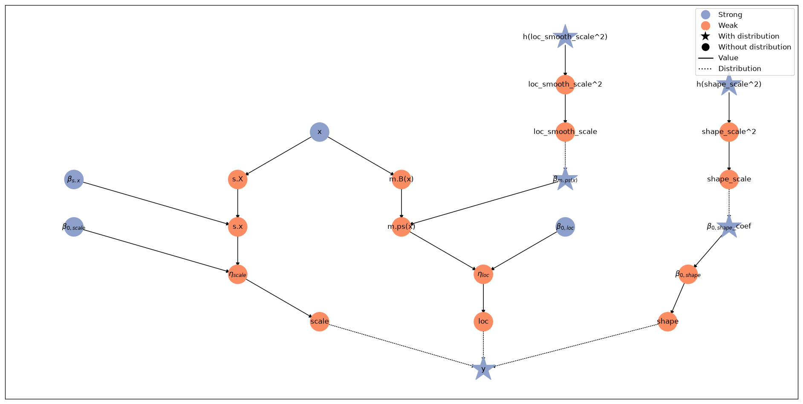
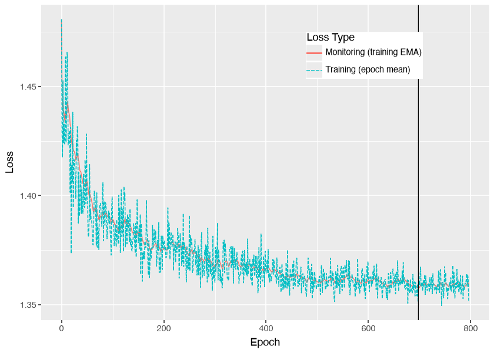
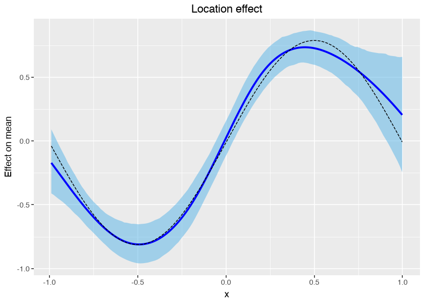
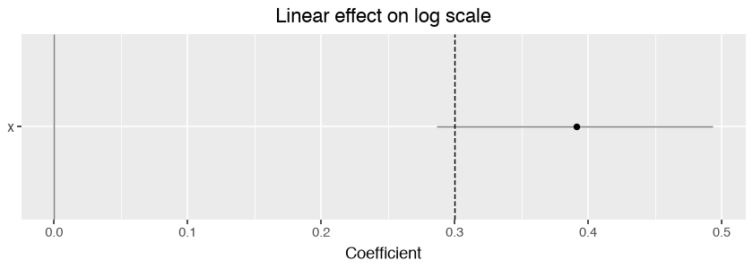
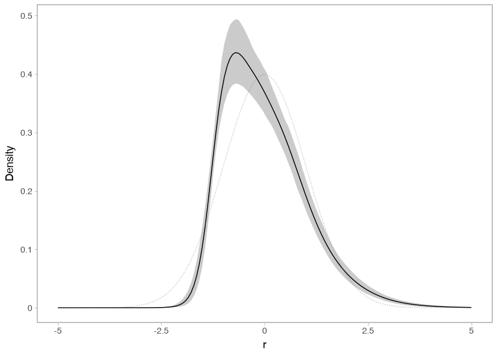
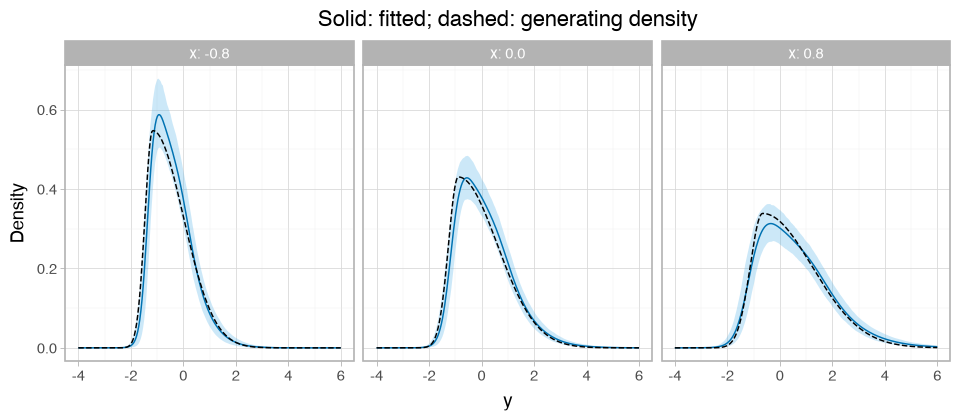

# Fit a fixed-shape PTM


Fit a penalized transformation model (PTM) with a shared standardized shape and
covariate effects on the conditional mean and standard deviation. This guide
starts with synthetic data, fits the model with variational inference (VI), and
compares its predictions with the distribution that generated the observations.

Run the cells from top to bottom in a fresh session with the
[checkout environment](../contributing.md#build-the-documentation).
Graphviz is needed for the model graph. The example uses 500 observations.

## Define the task and data

The response $Y_i$ has conditional mean $\mu_i$, standard deviation $\sigma_i$,
and one shared shape vector $\delta$. The
[current PTM formulation](https://arxiv.org/abs/2609.02662) transforms the
standardized response to a normal reference scale:

$$
P(Y_i \le y) = \Phi\left(h_\delta((y - \mu_i) / \sigma_i)\right).
$$

Estimate the location, log-scale, and shape coefficients, together with the
location and shape smoothing variances. Keep the knot grid and the hyperparameters
of the variance priors fixed.
Here, “fixed shape” means shared across observations; the shape is estimated.

``` python
import jax
import jax.numpy as jnp
import liesel.optim as opt
import liesel_gam as gam
import numpy as np
import optax
import pandas as pd
import plotnine as p9
import tensorflow_probability.substrates.jax.distributions as tfd
from IPython.display import Markdown

import liesel_ptm as ptm
```

``` python
rng = np.random.default_rng(42)
x = rng.uniform(-1.0, 1.0, 500)
error_dist = tfd.TwoPieceNormal(loc=0.0, scale=1.0, skewness=2.0)
errors = error_dist.sample(x.size, seed=jax.random.key(43))
residual = np.asarray((errors - error_dist.mean()) / error_dist.stddev())
y = 0.8 * np.sin(np.pi * x) + np.exp(0.3 * x) * residual
registry = gam.PandasRegistry(pd.DataFrame({"x": x, "y": y}))
```

The synthetic data follow $Y = 0.8\sin(\pi x) + e^{0.3x}\varepsilon$, with
$x \sim U(-1,1)$ and a standardized, right-skewed two-piece normal error.
The error has mean zero, variance one, and support on the whole real line.

## Define the model

[PTM](../api/models.md#liesel_ptm.PTM) creates location, scale, and shape
predictors, each with an intercept. Add a smooth effect to location and a linear
effect to log scale. Leave shape with its shared intercept. Give the location
P-spline’s smoothing variance a Weibull prior with `gam.scale_wb()`: `value=1.0`
initializes the smoothing standard deviation $\tau$, while `scale=1.0` sets
the Weibull prior scale for $\tau^2$.

``` python
model = ptm.PTM(registry.get_obs("y"), nshape=8, bounds=(-4.0, 4.0))
tb_loc = gam.TermBuilder(registry, prefix_names_by="m.")
tb_scale = gam.TermBuilder(registry, prefix_names_by="s.")
loc_smooth_scale = gam.scale_wb(value=1.0, scale=1.0, name="loc_smooth_scale")

model.pred.loc += tb_loc.ps("x", k=8, scale=loc_smooth_scale)
model.pred.scale += tb_scale.lin("x", name="s.x")
```

The scale predictor uses an exponential inverse link. The constructor’s onion
spline and standardization make location and scale the conditional mean and
standard deviation; see the [paper](https://arxiv.org/abs/2609.02662) and
[PTM reference](../api/models.md#liesel_ptm.PTM) for the construction and settings.
Add all terms before creating inference objects.

``` python
model.plot(width=20, height=10)
```



## Find starting values

First optimize the model’s log posterior. These point estimates initialize the
variational family; they are not posterior draws.

``` python
map_result = opt.LieselOptim(
    model,
    optimizers=optax.adam(0.01),
    loss_monitor="train_full_data",
    stopper=opt.Stopper(epochs=600, patience=600),
    seed=43,
    show_progress=False,
).fit()
model.state = model.update_state(map_result.position_min_monitor)
```

## Fit a variational family

Use one full-covariance Gaussian for all coefficients and log smoothing variances.
In parameter names such as `h(loc_smooth_scale^2)`, `h(...)` marks Liesel’s
transformed parameter: here the exponential bijector makes it a log variance.
Monitor the training loss with an exponential moving average (EMA) and stop on a
plateau, with a 3,000-epoch cap.

``` python
vi = opt.LieselVI(
    model,
    loss="mvn_tril",
    nsamples=8,
    optimizers=optax.adam(0.003),
    loss_monitor=opt.EmaTrainLossMonitor(effective_window=20),
    stopper=opt.Stopper(epochs=3000, patience=100, min_epochs=300, rtol=1e-4),
    seed=44,
    show_progress=False,
)
result = vi.fit()
```

``` python
result.status, result.n_epochs
```

    ('early_stopping', 797)

`early_stopping` means the EMA plateau criterion was reached; `max_epochs` means
the cap was reached. Inspect the loss trace too.

``` python
result.plot_loss()
```



A loss plateau is not an accuracy check. Gaussian VI often gives intervals that
are too narrow, even when optimization has converged.

``` python
posterior = vi.loss.approximate_joint_posterior(result)
samples = posterior.sample((1, 1000), seed=jax.random.key(45))
```

The first two axes are `(sample group, draw)`, here `(1, 1000)`. These 1,000 draws
are used for summaries and plots; they are separate from the eight samples used
to estimate the training objective. More draws reduce Monte Carlo noise in the
summaries without improving the fitted family itself.

The sample dictionary includes both coefficients and log smoothing variances:

``` python
sample_shapes = pd.DataFrame(
    {"parameter": list(samples), "dims": [value.shape for value in samples.values()]}
)
Markdown(sample_shapes.to_markdown(index=False))
```

| parameter               | dims         |
|:------------------------|:-------------|
| $\beta_{0,loc}$         | (1, 1000)    |
| $\beta_{0,scale}$       | (1, 1000)    |
| $\beta_{0,shape}$\_coef | (1, 1000, 7) |
| $\beta_{m.ps(x)}$       | (1, 1000, 7) |
| $\beta_{s.x}$           | (1, 1000, 1) |
| h(loc_smooth_scale^2)   | (1, 1000)    |
| h(shape_scale^2)        | (1, 1000)    |

## Plot location and scale effects

Use liesel-gam’s `plot_1d_smooth()` for the smooth location term. Its blue curve
and ribbon show the posterior mean and a pointwise 90% credible band. The
dashed curve is the generating effect. The smooth excludes the location intercept;
the generating effect is centered over the training inputs to match the smooth.

``` python
effect_x = np.linspace(x.min(), x.max(), 100)
true_effect = 0.8 * np.sin(np.pi * effect_x) - np.mean(0.8 * np.sin(np.pi * x))
true_location = pd.DataFrame({"x": effect_x, "effect": true_effect})
location_effect = gam.plot_1d_smooth(
    model.pred.loc.terms["m.ps(x)"], samples, show_n_samples=0
)
```

``` python
(
    location_effect
    + p9.geom_line(
        p9.aes("x", "effect"),
        data=true_location,
        inherit_aes=False,
        linetype="dashed",
    )
    + p9.labs(title="Location effect", y="Effect on mean")
)
```



The scale effect is linear, so use liesel-gam’s `plot_forest()` to inspect its
coefficient. The dashed line marks the generating log-scale slope of `0.3`.
A one-unit increase in `x` multiplies the conditional standard deviation by
`exp(slope)`.

``` python
(
    gam.plot_forest(
        model.pred.scale.terms["s.x"], samples, ymin="q_0.05", ymax="q_0.95"
    )
    + p9.geom_hline(yintercept=0.3, linetype="dashed")
    + p9.labs(title="Linear effect on log scale", x="", y="Coefficient")
    + p9.theme(figure_size=(7, 2.5))
)
```



## Predict at new covariates

Use `model.predict()` to evaluate the conditional parameters at every draw.

``` python
new_x = np.array([-0.8, 0.0, 0.8])
prediction = model.predict(
    samples, predict=["loc", "scale", "shape"], newdata={"x": new_x}
)
parameter_means = pd.DataFrame(
    {
        "x": new_x,
        "mean location": prediction["loc"].mean(axis=(0, 1)),
        "mean scale": prediction["scale"].mean(axis=(0, 1)),
    }
).round(3)
```

``` python
Markdown(parameter_means.to_markdown(index=False))
```

|    x | mean location | mean scale |
|-----:|--------------:|-----------:|
| -0.8 |         -0.42 |      0.741 |
|    0 |         0.121 |      1.011 |
|  0.8 |         0.586 |      1.384 |

Location and scale arrays have axes `(sample group, draw, new observation)`.
Shared shape has axes `(sample group, draw, shape coefficient)`, with no
observation axis. The table averages the conditional mean and standard deviation
over draws; its scale column is not the standard deviation of the posterior
predictive mixture.

## Inspect the shared shape

Remove location and scale to inspect the distribution induced by the shape
intercept. The dotted reference is standard normal.

``` python
ptm.plot_intercept_dist(model.response, model.pred.shape.intercept, samples)
```



Look for a sharper peak and a longer right tail than the reference. The same
standardized shape applies at every `x`.

## Compare fitted and true conditional distributions

Include both location and scale in
[summarise_conditional_dist](../api/summaries.md#liesel_ptm.summarise_conditional_dist)
to compare complete response densities. The generating density follows from
the same two-piece normal used above. Undo its standardization and include the
change-of-scale factor when evaluating the density. The density is defined on the
whole real line; the plotted response grid only selects the visible interval.

``` python
def true_density(y, x):
    mu = 0.8 * np.sin(np.pi * x)
    sigma = np.exp(0.3 * x)
    generator = error_dist
    raw_error = generator.mean() + generator.stddev() * (y - mu) / sigma
    return np.asarray(generator.prob(raw_error) * generator.stddev() / sigma)


comparison = ptm.summarise_conditional_dist(
    model.response,
    samples,
    newdata={"x": new_x},
    rgrid=jnp.linspace(-4.0, 6.0, 240),
    include_loc=True,
    include_scale=True,
)
density = comparison.loc[comparison["quantity"] == "density"].copy()
density["truth"] = true_density(density["r"].to_numpy(), density["x"].to_numpy())
```

``` python
(
    p9.ggplot(density, p9.aes("r"))
    + p9.geom_ribbon(p9.aes(ymin="q_0.05", ymax="q_0.95"), fill="#56B4E9", alpha=0.3)
    + p9.geom_line(p9.aes(y="mean"), color="#0072B2")
    + p9.geom_line(p9.aes(y="truth"), linetype="dashed")
    + p9.facet_wrap("~x", nrow=1, labeller="label_both")
    + p9.labs(title="Solid: fitted; dashed: generating density", x="y", y="Density")
    + p9.theme_light()
    + p9.theme(figure_size=(8, 3.5))
)
```



The solid blue curves average densities over draws, rather than evaluating the
density at mean coefficients. Bands are pointwise 90% credible bands; dashed
curves show the generating densities. Compare the peaks and right tails: one
shared standardized shape must account for all three panels. Finite data, spline
approximation, and VI can all contribute to differences from the truth.

Continue with the [conditional-shape guide](conditional-shape.md) when shape
should also depend on covariates. The [legacy guide](legacy.md) covers the earlier
transformation construction and computed intercepts; it is a separate formulation.
