# Inspect distribution effects


Use distribution plots to inspect how a transformation-predictor term changes
standardized shape, or how the complete response distribution changes across
covariate values. Each example below produces a plot.

The examples use small synthetic inputs and simulated coefficient draws; no model
is fitted. The ribbons illustrate variation across those draws, rather than
uncertainty learned from observations. For a fitted model, supply its posterior
sample dictionary in the same form. The
[conditional-shape PTM guide](conditional-shape.md) shows that fitting workflow.

Run this guide from a [repository checkout](../contributing.md#build-the-documentation).
The spatial example uses the bundled Columbus data and polygons.

## Prepare the examples

The distribution constructor uses the onion spline with centering and scaling
enabled. Term-induced distributions therefore have mean zero and standard
deviation one; their differences describe standardized shape.

``` python
from pathlib import Path

import jax
import jax.numpy as jnp
import liesel.model as lsl
import liesel_gam as gam
import numpy as np
import pandas as pd
import plotnine as p9
import tensorflow_probability.substrates.jax.bijectors as tfb
from IPython.display import Markdown

import liesel_ptm as ptm

dist = ptm.onion_dist(nparam=4, centered=True, scaled=True)
dimension_scale = jnp.eye(4)
keys = jax.random.split(jax.random.key(42), 10)
```

This helper creates 40 coefficient draws around a seeded synthetic center.
The first two array axes are `(sample group, draw)`, here `(1, 40)`; the remaining
axes match the term’s coefficient array. These axes also match the dictionaries
used by the plotting helpers after fitting.

``` python
def simulated_samples(term, key, scale=0.08, center=None):
    center_key, draw_key = jax.random.split(key)
    if center is None:
        center = 0.5 * jax.random.normal(center_key, term.coef.value.shape)
    sample_shape = (1, 40) + term.coef.value.shape
    values = center + scale * jax.random.normal(draw_key, sample_shape)
    return {term.coef.name: values}
```

## Plot a smooth shape effect

Create a small P-spline term and attach it to a Liesel model so it can be evaluated
at new covariate values. The distribution plots isolate this term: sibling terms,
location, scale, and the shape intercept are excluded unless requested explicitly.

``` python
smooth_data = pd.DataFrame({"x": np.linspace(-1.0, 1.0, 20)})
smooth_builder = gam.MVTermBuilder.from_df(smooth_data, dimension_scale)
smooth = smooth_builder.ps("x", k=5, scale=1.0, dimension_scale=1.0)
smooth_model = lsl.Model(smooth)
smooth_samples = simulated_samples(smooth, keys[1])
```

[plot_1d_smooth_dist](../api/plots.md#liesel_ptm.plot_1d_smooth_dist) places density
curves on covariate baselines. Increasing values of `x` appear higher in the stack
and use the high end of the color scale.

``` python
ptm.plot_1d_smooth_dist(
    dist,
    smooth,
    smooth_samples,
    rgrid=100,
    ngrid=5,
    ridge_spacing=0.3,
)
```

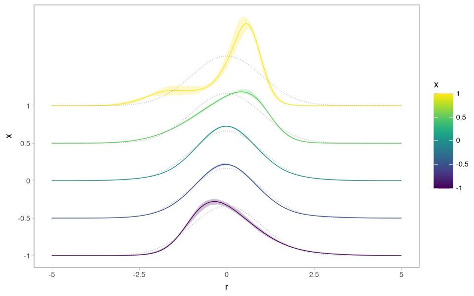

Compare the curves’ skewness and concentration rather than their vertical position:
the offsets separate the ridges and are not density values. Gray dotted curves
show the reference distribution. Ribbons contain the pointwise 5th to 95th
percentiles of the supplied draws. With fitted posterior samples, these ribbons
would describe posterior variation.

The helper evaluates five covariate values by default. An integer `rgrid` uses
`[-5, 5]`; pass an explicit array to choose another response grid. Set
`show_ridge_baselines=True` to draw baseline guides or `show_y_axis=False` to hide
the covariate labels. With `ridge_spacing=0.0`, curves overlap on a density axis.

### Compare CDFs and transformations

Use `quantity="cdf"` to inspect cumulative probabilities on the standardized scale.
Here three covariate values keep the overlapping curves easy to compare.

``` python
ptm.plot_1d_smooth_dist(
    dist,
    smooth,
    smooth_samples,
    quantity="cdf",
    rgrid=100,
    ngrid=3,
    ci_quantiles=None,
)
```

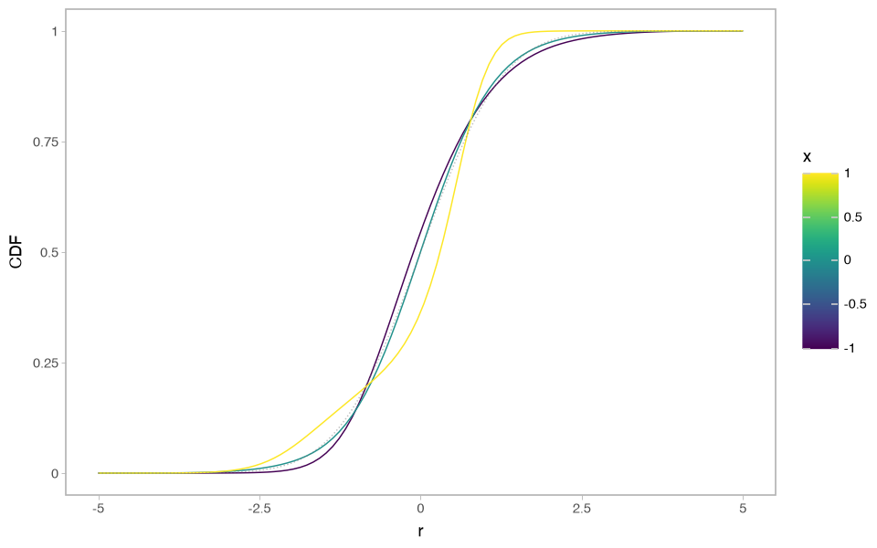

CDF differences show where probability accumulates more quickly. The transformation
plot instead shows the monotone map from the standardized response to the normal
reference scale. Its gray dotted identity line represents the reference shape.

``` python
ptm.plot_1d_smooth_dist(
    dist,
    smooth,
    smooth_samples,
    quantity="transformation",
    rgrid=100,
    ngrid=3,
    ci_quantiles=None,
)
```

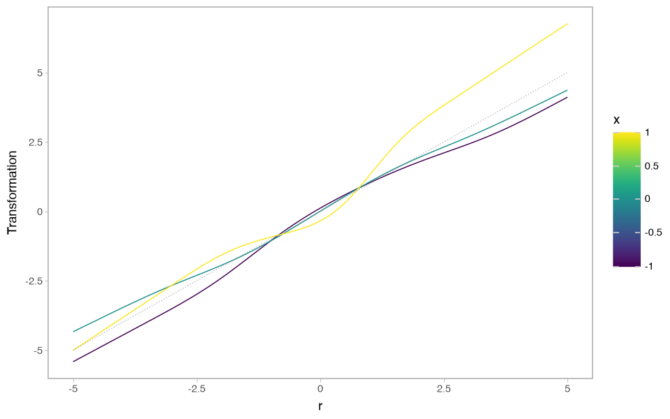

Use `quantity="transformation_raw"` for the spline transformation before its
centering and scaling corrections. These two transformations can differ even
when they describe the same standardized shape.

### Inspect numerical summaries

[summarise_1d_smooth_dist](../api/summaries.md#liesel_ptm.summarise_1d_smooth_dist)
returns the numerical values behind the display. Compare densities near a
standardized response of zero at five values of `x`.

``` python
summary = ptm.summarise_1d_smooth_dist(
    dist,
    smooth,
    smooth_samples,
    rgrid=jnp.linspace(-3.0, 3.0, 61),
    ngrid=5,
)
density_at_zero = summary.loc[
    (summary["quantity"] == "density") & (summary["r"].abs() < 0.1),
    ["x", "r", "mean", "q_0.05", "q_0.95", "sample_size"],
].round(3)
```

``` python
Markdown(density_at_zero.to_markdown(index=False))
```

|    x |    r |  mean | q_0.05 | q_0.95 | sample_size |
|-----:|-----:|------:|-------:|-------:|------------:|
|   -1 | -0.1 | 0.418 |  0.398 |  0.435 |          40 |
|   -1 |    0 | 0.404 |  0.386 |  0.423 |          40 |
| -0.5 | -0.1 | 0.429 |  0.421 |  0.438 |          40 |
| -0.5 |    0 | 0.431 |  0.424 |  0.438 |          40 |
|    0 | -0.1 | 0.434 |  0.429 |  0.439 |          40 |
|    0 |    0 | 0.436 |  0.432 |   0.44 |          40 |
|  0.5 | -0.1 | 0.364 |  0.356 |  0.374 |          40 |
|  0.5 |    0 | 0.379 |   0.37 |  0.389 |          40 |
|    1 | -0.1 | 0.297 |  0.255 |  0.346 |          40 |
|    1 |    0 | 0.352 |  0.301 |  0.414 |          40 |

`mean` averages density values over draws. It is not the density evaluated at an
average coefficient vector. The `quantity` column also contains CDF, transformation,
and raw-transformation rows; further columns include `sd`, `var`, `hdi_low`, and
`hdi_high`. `sample_size` counts the supplied draws.

## Plot the shape intercept

The shape intercept supplies a common standardized distribution. It is excluded
from the smooth-term plot above. Create an intercept example to inspect that
shared contribution by itself.

``` python
intercept_builder = gam.MVTermBuilder.from_df(
    pd.DataFrame({"x": [0.0, 1.0]}), dimension_scale
)
intercept = intercept_builder.intercept(scale=0.1)
intercept_model = lsl.Model(intercept)
intercept_samples = simulated_samples(intercept, keys[0], scale=0.12)
```

``` python
ptm.plot_intercept_dist(
    dist,
    intercept,
    intercept_samples,
    rgrid=100,
    show_n_samples=4,
    seed=4,
)
```

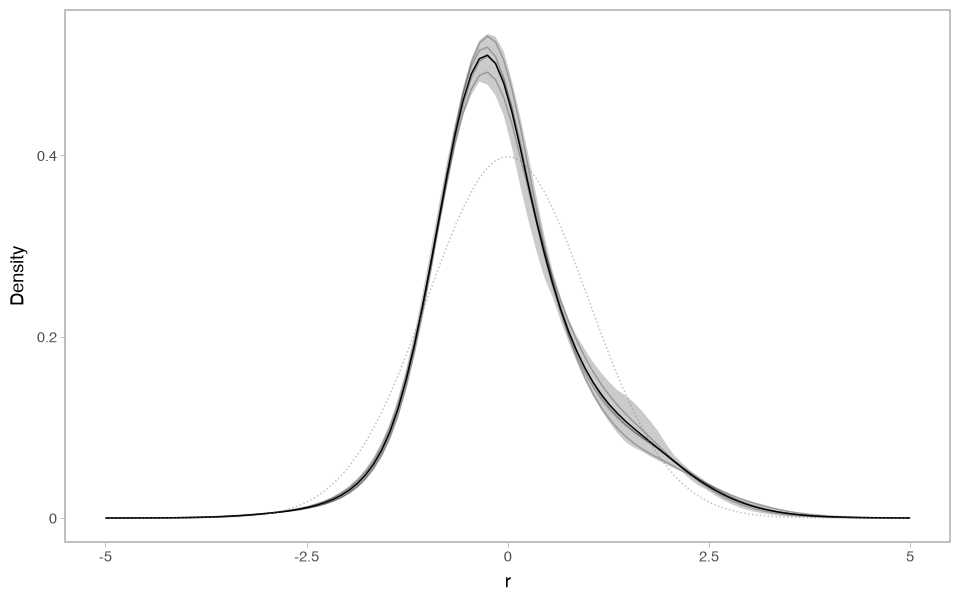

The solid density summarizes the draws; transparent trajectories show four
reproducibly selected draws. Use `show_n_samples` and `seed` for this display.
Pass `hdi_prob` to add HDI lines, or `show_reference_dist=False` to omit the
reference distribution.

To combine a smooth term with an intercept, pass the concrete intercept variable
as `intercept=...`. The shorthand `intercept=True` is unsupported because a term
does not reliably identify its owning predictor.

## Plot conditional response distributions

A term-induced display answers a different question from a complete conditional
response distribution. The next example defines location and scale predictors
with chosen coefficient values and a shared normal shape. It is a plotting
example, not a fit to the two placeholder observations.

``` python
model = ptm.PTM(jnp.zeros(2), nshape=4, shape_scale=0.1)
conditional_builder = gam.TermBuilder.from_dict(
    {"x": jnp.array([0.0, 1.0]), "z": jnp.array([0.0, 1.0])}
)
loc_effect = conditional_builder.lin("x", name="location_effect")
scale_effect = conditional_builder.lin("z", name="scale_effect")
model.pred.loc += loc_effect
model.pred.scale += scale_effect

samples = {
    name: jnp.zeros((1, 1) + jnp.shape(var.value))
    for name, var in model.parameters.items()
}
samples[loc_effect.coef.name] = jnp.ones((1, 1, 1))
samples[scale_effect.coef.name] = jnp.full((1, 1, 1), jnp.log(2.0))
```

[PTM](../api/models.md#liesel_ptm.PTM) supplies the standardized transformation
and intercepts. The sample dictionary has one chosen value for every parameter:
zero intercepts and shape coefficients, a location slope of one, and a log-scale
slope of `log(2)`. These values give a normal distribution with mean `x` and
standard deviation `2**z`; they are not fitted estimates.

Each `newdata` row specifies one condition. Enable `include_loc` and
`include_scale` to include both predictors, and supply `rgrid` in response units.
The default conditional plot isolates standardized shape by fixing location to
zero and scale to one.

``` python
cases = [
    {"x": 0.0, "z": 0.0},
    {"x": 0.5, "z": 0.5},
    {"x": 1.0, "z": 1.0},
]
```

``` python
ptm.plot_conditional_dist(
    model.response,
    samples,
    newdata=cases,
    condition_labels=["A", "B", "C"],
    rgrid=jnp.linspace(-7.0, 9.0, 160),
    include_loc=True,
    include_scale=True,
    ci_quantiles=None,
)
```

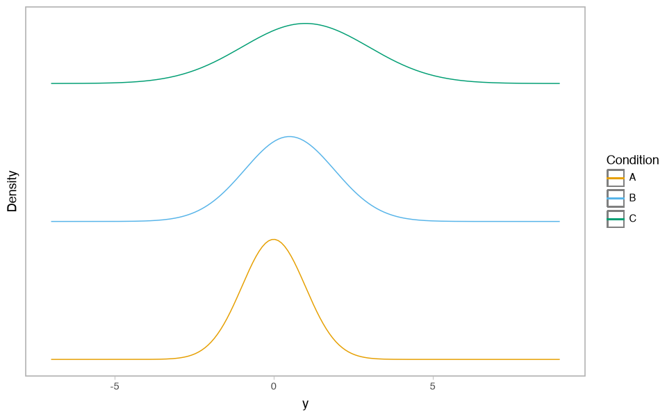

The curves move and widen because location and scale change; their standardized
shape is the same. Conditional plots show no reference curve. This example has
only one draw, so ribbons are disabled.

New data can be equal-length arrays or scalar-valued records, as above. Rows are
used directly: the conditional helpers do not form a Cartesian grid or infer
missing covariates, and duplicate rows are rejected. Custom condition labels must
be unique and follow the input-row order. Without them, legends show the covariate
values. Use
[summarise_conditional_dist](../api/summaries.md#liesel_ptm.summarise_conditional_dist)
for a tidy numerical summary.

### Show a transformed response scale

If the modeled response is a logarithm, `tfb.Exp()` maps it back to positive
response units. Supply the grid on that reported scale.

``` python
ptm.plot_conditional_dist(
    model.response,
    samples,
    newdata=cases,
    condition_labels=["A", "B", "C"],
    rgrid=jnp.geomspace(0.01, 25.0, 240),
    include_loc=True,
    include_scale=True,
    ci_quantiles=None,
    response_bijector=tfb.Exp(),
) + p9.labs(x="Response on original scale")
```

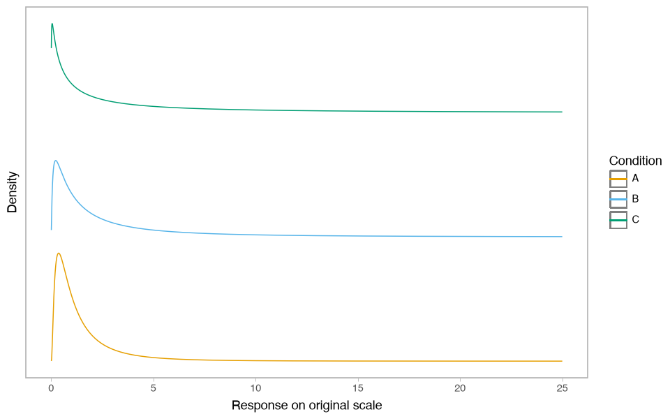

The transformed densities are skewed, and the chosen range shows only part of
their right tails. Density and CDF values follow the transformed distribution;
transformation curves compose the fitted transformation with the bijector’s
inverse. Plotnine labels can replace the default axis title, as shown here.

## Compare categorical effects

Create a categorical term with three observed groups and one unobserved level.
Each group has its own term-induced standardized distribution.

``` python
groups = pd.Categorical(["a", "b", "a", "c", "b"], categories=["a", "b", "c", "d"])
cluster_builder = gam.MVTermBuilder.from_df(
    pd.DataFrame({"group": groups}), dimension_scale
)
cluster = cluster_builder.ri("group", scale=1.0, dimension_scale=1.0)
cluster_model = lsl.Model(cluster)
cluster_samples = simulated_samples(cluster, keys[6], scale=0.10)
```

``` python
ptm.plot_cluster_dist(
    dist,
    cluster,
    cluster_samples,
    rgrid=100,
    show_unobserved=True,
    ridge_spacing=0.3,
)
```

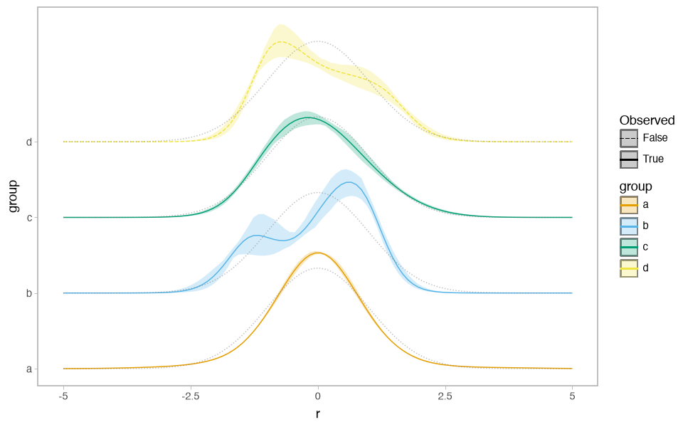

Group `d` is in the category mapping but absent from the observations. Its dashed
line distinguishes it from observed groups. All coefficients here are simulated;
this does not demonstrate what an unobserved group’s posterior would look like.
Categories use the Okabe-Ito palette up to eight levels, then discrete viridis.
You can replace the plotnine color and fill scales.

## Inspect a two-input interaction

For the tensor examples, use a small basis with a constant and a linear component
per input. This keeps the examples quick while producing a genuine multivariate
tensor term. An analysis can use richer bases, such as P-splines.

``` python
def linear_basis(x):
    x = jnp.squeeze(x, axis=-1)
    return jnp.column_stack((jnp.ones_like(x), x))
```

``` python
tensor2_data = pd.DataFrame(
    {
        "x": np.linspace(0.0, 1.0, 20),
        "z": np.linspace(-1.0, 1.0, 20),
    }
)
scalar2_builder = gam.TermBuilder.from_df(tensor2_data)
mv2_builder = gam.MVTermBuilder.from_term_builder(scalar2_builder, dimension_scale)
scalar_x = scalar2_builder.f(
    "x", basis_fn=linear_basis, penalty=jnp.eye(2), scale=1.0, use_callback=False
)
scalar_z = scalar2_builder.f(
    "z", basis_fn=linear_basis, penalty=jnp.eye(2), scale=1.0, use_callback=False
)
tensor2 = mv2_builder.tx(scalar_x, scalar_z, dimension_scale=1.0)
main_x = mv2_builder.f(
    "x",
    basis_fn=linear_basis,
    penalty=jnp.eye(2),
    scale=1.0,
    dimension_scale=1.0,
    use_callback=False,
)
tensor2_intercept = mv2_builder.intercept(scale=1.0)
tensor2_model = lsl.Model([tensor2, main_x, tensor2_intercept])
tensor2_samples = {
    **simulated_samples(tensor2, keys[2], scale=0.06),
    **simulated_samples(main_x, keys[3], scale=0.08),
    **simulated_samples(tensor2_intercept, keys[4], scale=0.05),
}
```

Include the lower-order `main_x` term and the shape intercept explicitly. Other
marginals and sibling terms stay excluded. The second input defines the facets;
within each facet, color and ridge position identify the first input.

``` python
ptm.plot_2d_smooth_dist(
    dist,
    tensor2,
    tensor2_samples,
    rgrid=80,
    ngrid=3,
    facet_by="z",
    marginals=(main_x,),
    intercept=tensor2_intercept,
) + p9.theme(figure_size=(10, 4))
```

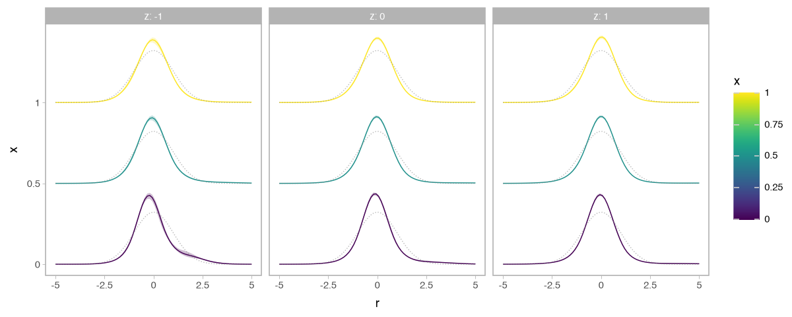

Compare ridges across `x` within a panel and across `z` between panels. This display
combines exactly the selected interaction, marginal, and intercept. With supplied
`newdata`, values are paired row by row unless `newdata_meshgrid=True` requests all
combinations. This convention applies to both two- and three-input terms.

## Inspect a three-input interaction

Use synthetic longitude, latitude, and a third covariate `z`. These coordinates
only illustrate the plotting layouts; they do not describe measured spatial data.

``` python
tensor3_data = pd.DataFrame(
    {
        "longitude": np.linspace(10.0, 11.0, 20),
        "latitude": np.linspace(50.0, 51.0, 20),
        "z": np.linspace(0.0, 1.0, 20),
    }
)
scalar3_builder = gam.TermBuilder.from_df(tensor3_data)
mv3_builder = gam.MVTermBuilder.from_term_builder(scalar3_builder, dimension_scale)


def scalar3(name, center, scale):
    def basis(x):
        return linear_basis((x - center) / scale)

    return scalar3_builder.f(
        name,
        basis_fn=basis,
        penalty=jnp.eye(2),
        scale=1.0,
        use_callback=False,
    )


tensor3 = mv3_builder.tx(
    scalar3("longitude", 10.5, 0.5),
    scalar3("latitude", 50.5, 0.5),
    scalar3("z", 0.5, 0.5),
    dimension_scale=1.0,
)
tensor3_model = lsl.Model(tensor3)
tensor3_center = 0.35 * jax.random.normal(keys[8], tensor3.coef.value.shape)
tensor3_samples = simulated_samples(tensor3, keys[5], scale=0.03, center=tensor3_center)
anchor_points = {
    "longitude": np.array([10.15, 10.50, 10.85]),
    "latitude": np.array([50.20, 50.75, 50.35]),
}
```

The faceted layout uses longitude and latitude for the panel grid, with one set of
density ridges over `z` in each panel. The mesh-grid option combines all supplied
longitude, latitude, and `z` values.

``` python
ptm.plot_3d_smooth_dist(
    dist,
    tensor3,
    tensor3_samples,
    x="longitude",
    y="latitude",
    ridge_by="z",
    newdata={**anchor_points, "z": [0.2, 0.5, 0.8]},
    newdata_meshgrid=True,
    rgrid=jnp.linspace(-3.0, 3.0, 80),
) + p9.theme(figure_size=(10, 8))
```

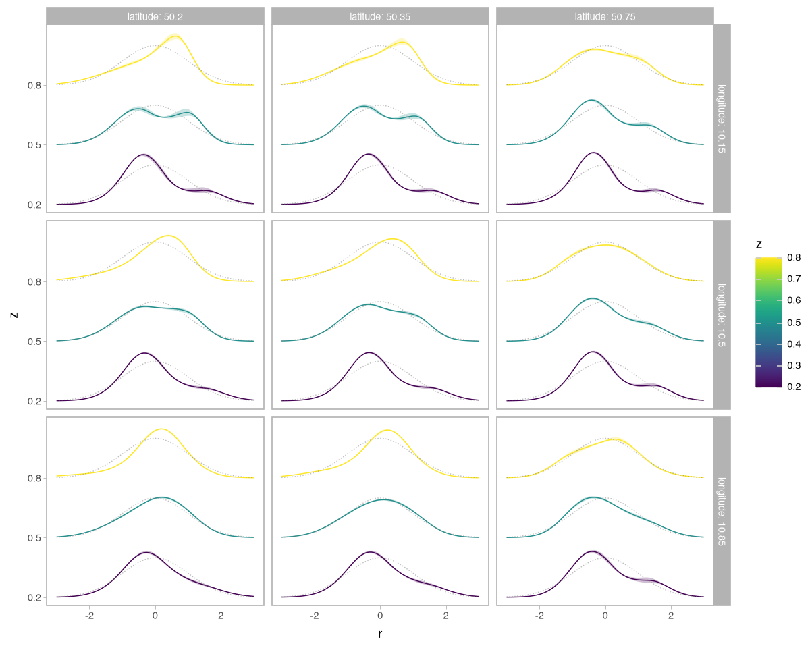

For paired spatial anchors, use the stacked layout. It draws one small density
stack at each supplied longitude/latitude pair rather than a rectangular facet
grid. Black crosses mark the anchors; higher `z` values have higher ridge offsets.

``` python
ptm.plot_3d_smooth_dist_stacked(
    dist,
    tensor3,
    tensor3_samples,
    x="longitude",
    y="latitude",
    ridge_by="z",
    ridge_spacing=0.02,
    points=anchor_points,
    ridge_values=[0.2, 0.5, 0.8],
    rgrid=jnp.linspace(-5.0, 5.0, 80),
    glyph_width=0.15,
    point_size=3.5,
    point_shape="+",
    point_color="#222222",
)
```

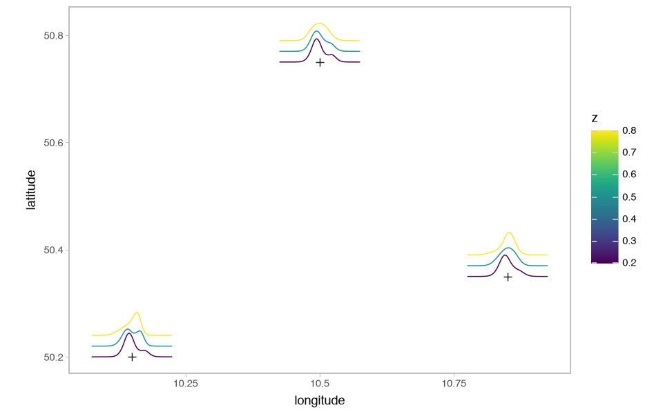

The `point_*` arguments control the anchor marks. These spatial stacks omit
uncertainty bands by default; request `ci_quantiles` or `hdi_prob` when the added
marks remain readable. Their horizontal glyph width scales the miniature response
axis and is not a geographical distance.

## Put density glyphs on a region map

The final example uses the Columbus district polygons bundled with the repository.
They are exports from R’s **mgcv** package; the data originate from Anselin (1988),
*Spatial econometrics: methods and models*. See the
[data provenance](https://github.com/liesel-devs/liesel-ptm/blob/main/demo/data/README.md).
Only the geometry and district labels are used; the shape coefficients are simulated.

The paths below are relative to this guide in `docs/guides/`. Convert the polygon
rows to the mapping accepted by a native liesel-gam MRF term.

``` python
columb_dir = Path("../../demo/data")
columb = pd.read_csv(columb_dir / "columb.csv", index_col=0, dtype={"district": str})
districts = [str(i) for i in range(columb["district"].nunique())]
columb["district"] = pd.Categorical(columb["district"], categories=districts)
polys_df = pd.read_csv(columb_dir / "columb_polys.csv", dtype={"label": str})
columb_polys = {
    str(label): group.sort_values("vertex")[["x", "y"]].to_numpy() - 1.0
    for label, group in polys_df.groupby("label", sort=False)
}

region_builder = gam.MVTermBuilder.from_df(columb, dimension_scale)
region = region_builder.mrf(
    "district",
    polys=columb_polys,
    scale=1.0,
    dimension_scale=1.0,
)
region_model = lsl.Model(region)
region_center = jnp.linspace(-0.35, 0.35, region.coef.value.size).reshape(
    region.coef.value.shape
)
region_samples = simulated_samples(region, keys[7], scale=0.04, center=region_center)
```

[plot_regions_dist](../api/plots.md#liesel_ptm.plot_regions_dist) discovers the
polygons on the term and places a density glyph at each polygon’s centroid.
Here outlines keep the overlapping map and density marks readable.

``` python
ptm.plot_regions_dist(
    dist,
    region,
    region_samples,
    rgrid=60,
    show_density_fill=False,
    glyph_width=0.5,
    glyph_height=0.2,
) + p9.theme(figure_size=(10, 7))
```

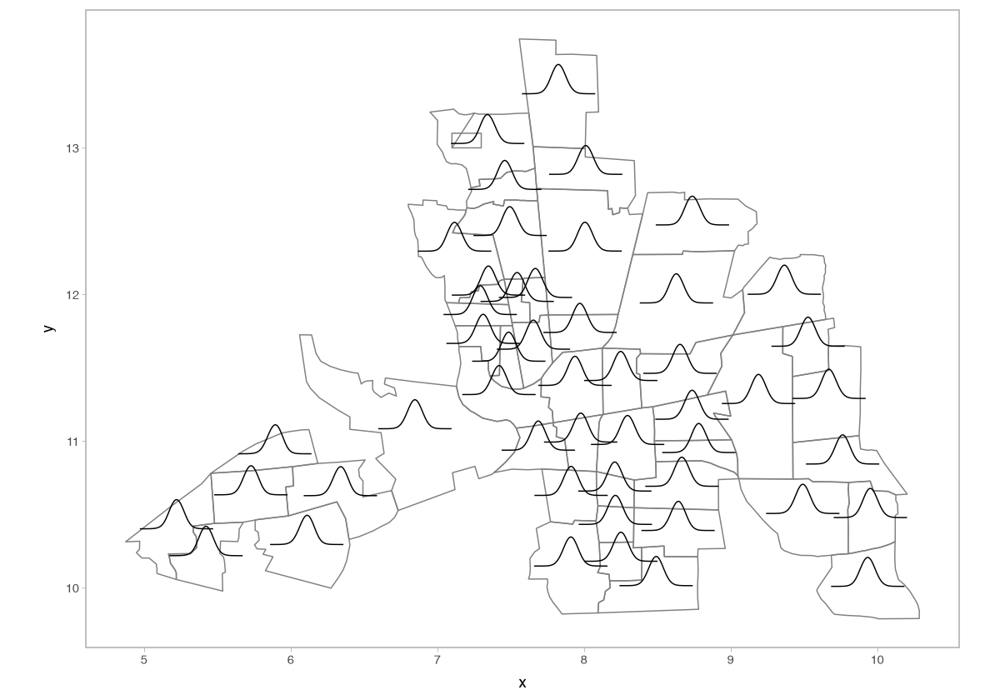

These are small distributions, not a scalar-filled map: compare their shapes at
each district. The glyph offsets are a display device, not an additional response
or spatial dimension. Override selected anchors with `locations={label: (x, y)}`.
If a category has no polygon, supply its location explicitly. Setting
`show_density_fill=False` removes the density fill; requested quantile or HDI
bands are controlled separately.

For argument details and other displays, see the
[plot reference](../api/plots.md) and [summary reference](../api/summaries.md).
